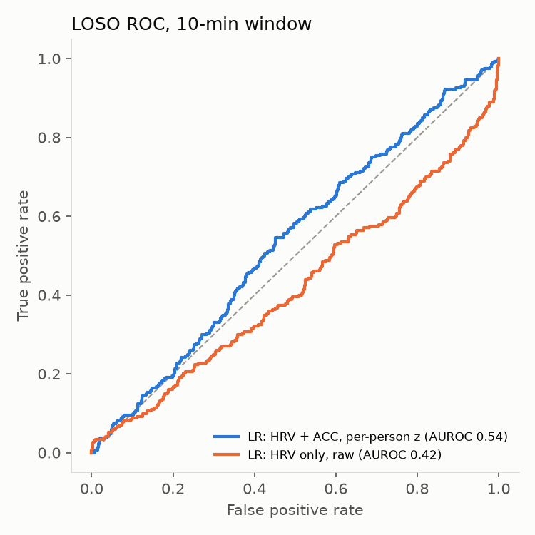
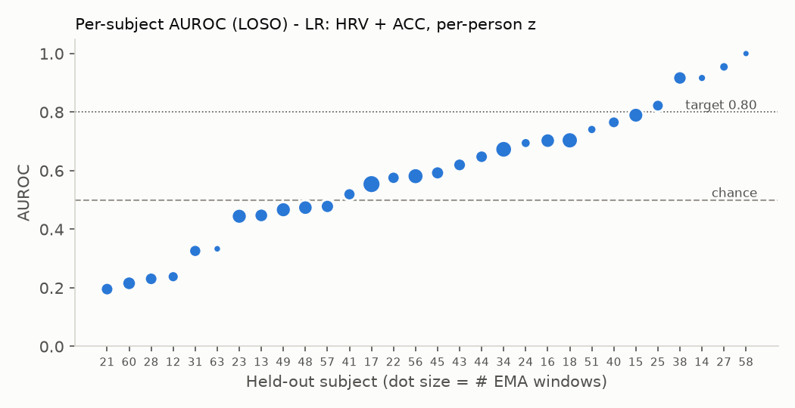
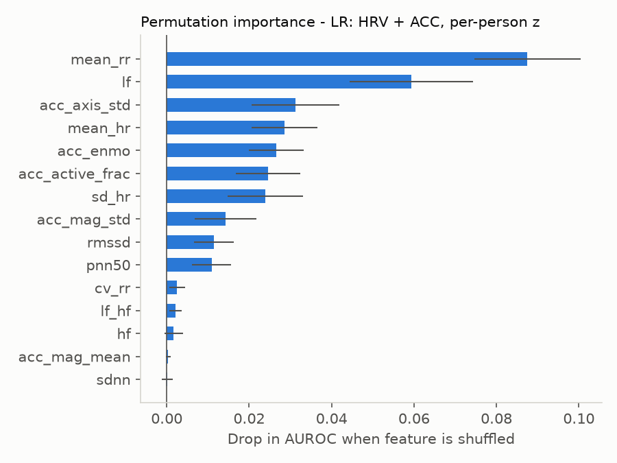

# JITAI Project – Milestones / Analysis

**Team:** William Wang, Jia Bo, James Li, Diamond Dang
**Status date:** November 3, 2026

| Milestone (from proposal) | Owner | Planned dates | Status |
|---|---|---|---|
| Data ETL | Jia | Oct 5 – Oct 22 | ✅ Done |
| Logistic classifier | William | Oct 27 – Nov 14 | ✅ First full version done (LOSO evaluated) |
| Random forest | Diamond | Oct 27 – Nov 14 | ⏳ In progress (uses the same feature table) |
| Model evaluation / explainability | James | Nov 14 – Dec 4 | ⏳ Not started; groundwork below |

Code: `code/01_etl_features.py` (ETL + features), `code/02_logistic_classifier.py` (model + evaluation).
All outputs are in `outputs/`.

---

## 0. Change of scope: WESAD → RELAX dataset

The proposal planned to use **WESAD** (15 subjects, chest and wrist sensors, lab-induced baseline/stress/amusement conditions). We are now working with the **RELAX dataset**, which differs in ways that shaped every later decision:

| | WESAD (proposal) | RELAX (what we have) |
|---|---|---|
| Setting | Controlled lab, ~2 h per person | **Free-living**, ~6 weeks per person (Feb–Apr 2024) |
| Subjects | 15 | **31** |
| Sensors | ECG, EDA, EMG, respiration, skin temperature, ACC (chest + wrist) | **Only** PPG pulse-to-pulse intervals (IBI) + 3-axis ACC (Polar Verity Sense, ~52 Hz) |
| Labels | Protocol condition (baseline / stress / amusement) | **Self-reported EMA questionnaires** (morning, momentary, evening) |
| Size | ~2 GB pickle | **~27 GB** Parquet (ACC ≈ 1 GB per subject) |

Consequences:
- **No EDA, skin temperature, or respiration.** The planned EDA tonic/phasic and temperature-slope features cannot be computed. Features are limited to HRV (from IBI) and movement (from ACC).
- **No 3-class lab labels.** We redefined the task as **binary stress vs. non-stress** from a momentary self-report. This matches the proposal's "primary task: stress vs. non-stress".
- Labels are now subjective and sparse (about 70 EMAs per person) rather than dense protocol labels. This is a much harder and more realistic problem; see Section 3.

---

## 1. Milestone 1 – Data ETL and cleaning (done)

### 1.1 Labels (EMA questionnaires)
- Source: `questionnaire_responses.xlsx`, sheet `ifb` (momentary questionnaire). It has **2,109 responses from 31 subjects**, with 12–106 responses per subject. The item dictionary (`metadata/questionnaires.xlsx`) is in German with English translations.
- **Label definition:** item `ifb-2`, "I feel: *excited/agitated* (1) … *calm* (7)" (German: *aufgeregt … ruhig*). **Stress = 1 if score ≤ 3**, else 0.
  - This is the only momentary item that directly asks about current arousal and tension. Mental effort (`ifb-7`) and mood (`ifb-1`) are correlated with it (r = −0.27 and 0.48) but measure different things.
  - The cutoff gives a positive rate of **≈ 30%**. The score 4 (neutral) is counted as non-stress.
- **Timestamp alignment:** responses have both `manual_date` (epoch milliseconds) and `readable_date`. We confirmed that `readable_date` is the UTC rendering of `manual_date`. We used `manual_date` → UTC, which is the same clock as the sensor timestamps. No duplicate responses were found.

### 1.2 Interbeat-interval (IBI) cleaning
Each row is one detected heartbeat. The cleaning steps, with rows remaining after each step (all 31 subjects, 45.2 M beats in total):

| Step | Rule | Beats kept | % of raw |
|---|---|---|---|
| Raw | – | 45,222,037 | 100% |
| 1. Device artifact flag | drop `ibi_blocker == True` (device marks motion/signal artifact) | 28,962,604 | 64.0% |
| 2. Physiological range | keep 300 ms ≤ IBI ≤ 2000 ms (30–200 bpm) | 28,813,611 | 63.7% |
| 3. Device error estimate | keep `ibi_errorEstimate` ≤ 50 ms | 26,954,698 | 59.6% |
| 4. Ectopic/outlier beats | drop beats deviating > 20% from the rolling 5-beat median | 26,446,451 | **58.5%** |

Successive-difference HRV metrics (RMSSD, pNN50) are computed only between **truly consecutive** beats. If a beat was removed, the gap is not treated as one long interval.

### 1.3 Accelerometer (ACC)
- Raw device units are milli-g; the norm is about 1000 when the device is at rest.
- No filtering is applied for the current features, which are summary statistics of movement (see 1.4).

### 1.4 Windowing and features
For each EMA response we take the **10 minutes of sensor data ending at the response time**. A 30-minute window was also run as a sensitivity check. This is the EMA equivalent of the proposal's "60 s windows". With sparse self-reports, the label describes the person's state "right now", so we look at the period just before the report.

| Group | Features |
|---|---|
| HRV, time domain | mean RR, SDNN, RMSSD, pNN50, mean HR, SD HR, CV of RR |
| HRV, frequency domain | log LF power (0.04–0.15 Hz), log HF power (0.15–0.4 Hz), log LF/HF. Computed with a **Lomb–Scargle periodogram**, which handles the irregular beat timing and the gaps left by removed beats without interpolation |
| Movement (ACC) | mean and SD of acceleration magnitude, ENMO (mean of max(‖a‖ − 1 g, 0)), fraction of 1-second epochs with movement (SD > 50 mg), mean per-axis SD |

**Quality rules:**
- A window is **usable only if it contains ≥ 60 clean beats**, i.e. at least about 1 minute of valid heartbeats.
- ACC features are computed when at least 20% of the expected samples are present. Otherwise they are set to missing, imputed with the training-set median, and flagged with a missing-indicator feature.

**Per-person normalization** (proposal: "per-person norm. vs baseline"): each feature is z-scored within subject. This removes stable individual differences such as resting heart rate and fitness.

### 1.5 Output of ETL
- `outputs/ema_windows_features_{10,30}min.parquet`: one row per EMA response, with labels, features, and demographics (gender, birth-year group).
- `outputs/cleaning_report.csv`: per-subject beat counts after each cleaning step.

### 1.6 Issues faced during ETL
1. **Data volume and format.** ACC is about 2.16 billion samples (27 GB). Each subject's ACC file has only 2 Parquet row groups of about 42 M rows, so filtering by time on read still decompresses entire groups. *Fix:* stream one row group at a time, slice out only the EMA windows using binary search on the sorted timestamps, then discard the rest. Using 4 worker processes, the full ETL now runs in **about 1 minute**.
2. **Most EMAs have no usable physiology.** Of 2,109 EMA responses:
   - 958 (45%) have **no heartbeats at all** in the 10 minutes before them, meaning the sensor was not worn or not recording.
   - 260 more have fewer than 60 clean beats.
   - Only **891 (42%) are usable**.

   Widening to 30 minutes raises this to 1,131 (54%) but makes the window less "momentary". Coverage also varies a lot by subject (4–61 usable windows each).
3. **Heavy motion artifacts.** 36% of all beats are flagged by the device as unreliable, plus about 6% more removed by our rules. This matches the proposal's "noisy signals" roadblock. In free-living data it is the main source of loss.
4. **IBI and ACC streams do not always overlap.** 177 of the 891 usable windows have heartbeats but less than 20% ACC coverage. These are handled with imputation plus missing-indicators rather than dropped.
5. **Small engineering issues:**
   - pyarrow and openpyxl were missing from the environment.
   - German umlauts in the questionnaire crashed console output on Windows (GBK code page). Fixed by running Python in UTF-8 mode (`-X utf8`).

---

## 2. Milestone 2 – Logistic regression classifier (done, first version)

### 2.1 Setup
- **Model:** scikit-learn pipeline: median imputation (with missing indicators) → standard scaling → L2 logistic regression with `class_weight="balanced"` (positives are about 30%).
- **Evaluation:** **leave-one-subject-out (LOSO)**, 31 folds, as in the proposal.
  - Inside each fold, the regularization strength C ∈ {0.001, 0.01, 0.1, 1, 10} is tuned by **inner 5-fold GroupKFold over the training subjects only**, using AUROC.
  - Imputation and scaling are fit on training subjects only. The held-out subject is never seen during fitting or tuning.
- **Metrics:** AUROC (with 95% CI from a 1,000× bootstrap over subjects), balanced accuracy, F1 (threshold 0.5), and per-subject AUROC.
- **Baselines** (for the "F1 > baseline" criterion): always predict stress; stratified random guessing.
- **Variants compared:** HRV only vs. HRV + ACC; raw features vs. per-person z-scored features; 10-minute vs. 30-minute windows.

### 2.2 Results (LOSO)

**10-minute window, 891 windows, 31 subjects, 30.6% stress**

| Model | AUROC [95% CI] | Balanced acc. | F1 | Mean per-subject AUROC (± SD) |
|---|---|---|---|---|
| Dummy: always "stress" | 0.500 | 0.500 | 0.469 | – |
| Dummy: stratified random | 0.514 [0.49–0.53] | 0.514 | 0.348 | 0.54 ± 0.14 |
| LR, HRV only, raw | 0.422 [0.34–0.50] | 0.454 | 0.334 | 0.51 ± 0.16 |
| LR, HRV + ACC, raw | 0.454 [0.38–0.53] | 0.469 | 0.349 | 0.51 ± 0.20 |
| LR, HRV only, per-person z | 0.535 [0.48–0.59] | 0.539 | 0.418 | 0.57 ± 0.21 |
| **LR, HRV + ACC, per-person z** | **0.536 [0.48–0.59]** | **0.541** | **0.423** | **0.59 ± 0.23** |

**30-minute window, 1,131 windows, 30.9% stress**

| Model | AUROC [95% CI] | Balanced acc. | F1 | Mean per-subject AUROC (± SD) |
|---|---|---|---|---|
| Dummy: always "stress" | 0.500 | 0.500 | 0.473 | – |
| LR, HRV + ACC, raw | 0.460 [0.39–0.54] | 0.468 | 0.355 | 0.50 ± 0.18 |
| LR, HRV only, per-person z | 0.560 [0.53–0.61] | 0.534 | 0.409 | 0.60 ± 0.15 |
| **LR, HRV + ACC, per-person z** | **0.568 [0.53–0.61]** | **0.551** | **0.435** | **0.60 ± 0.15** |

Full table: `outputs/logistic_results.csv`.



### 2.3 Interpretation
- **Per-person normalization is essential.** Raw-feature models score *below* chance on new subjects (AUROC 0.42–0.46).
  - People differ in both baseline physiology and how often they report stress (0% to 88% stress reports per person).
  - With raw features, the model learns between-person patterns (e.g., "people with a lower resting HR report more stress"). These patterns do not hold *within* a new person.
  - After z-scoring within each person, the model learns within-person changes, and performance rises above chance.
- **The signal is real but weak.** The best model reaches AUROC 0.54 (10 min) / 0.57 (30 min). The 30-minute CI (0.53–0.61) excludes 0.5. This is **well below the proposal's AUROC > 0.80 target**.
- **F1 vs. baseline:** F1 is 0.42–0.44, which beats stratified guessing (0.35) but **not** the trivial "always stress" classifier (0.47). Because "always stress" has recall 1.0 and F1 rewards recall, it is a hard baseline at a 30% positive rate. Balanced accuracy and AUROC are the fairer comparison here.
- **Large per-subject variance:**
  - Per-subject AUROC ranges from **0.20 to 1.00** (see figure below).
  - 5 subjects are ≥ 0.80, while 6 are < 0.35.
  - For 12 of the 30 evaluable subjects, the model is near or below chance. (Subject 46 reported no stress in usable windows, so their AUROC is undefined.)

  This is the "small sample, per-subject variance" roadblock from the proposal, and it argues for **personalization**.



**Which signals matter.** Permutation importance and standardized coefficients come from the model fit on all subjects (`outputs/feature_importance_main.csv`).



- **Shorter RR interval / higher HR** relative to the person's own average is the strongest predictor of reported stress (mean RR coefficient −0.56; AUROC drop 0.09 when shuffled). This is physiologically plausible: sympathetic arousal raises heart rate.
- **Higher LF power** is the next strongest predictor, followed by movement features. Classic vagal markers such as RMSSD and HF contribute little in 10-minute free-living windows.
- Within person, stress windows differ from non-stress windows by only about **0.15 SD** on the top features. That explains the low AUROC.
- **Activity is a confounder.** The proposal's "key challenge" was separating stress from exercise. ACC features carry weight in the model, so part of the HR signal may be movement rather than stress. The planned JITAI rule "only trigger when activity is low" is therefore important.

**By group** (per-subject AUROC, main model). This is preliminary because the groups are small:
- By gender: men 0.60 (n = 10), women 0.59 (n = 19). No difference.
- By birth cohort:
  - 1980s: 0.65 (n = 12)
  - 1990s: 0.66 (n = 8)
  - 1970s: 0.43 (n = 6)
  - 1960s: 0.54 (n = 3)

  A possible age effect, worth checking in the evaluation milestone.

### 2.4 Issues faced in this milestone
1. **Label quality.** "Excited ↔ calm" is a subjective one-item proxy for stress, answered on a phone. Some "excited" responses may be positive arousal rather than stress. The ≤ 3 cutoff is a judgment call; other cutoffs and labels (e.g., mental effort) have not been tested yet.
2. **Weak, person-specific signal.** Even with correct LOSO handling, results are far from the 0.80 target. A generic model across people does not transfer well in free-living data. This is consistent with the literature, where in-the-wild results are much lower than lab results like WESAD's.
3. **Methodological caveats we want to be transparent about:**
   - Per-person z-scoring uses all of the held-out subject's *unlabeled* windows. This is like a calibration period, and no labels are used. A stricter version would normalize using only that person's baseline-phase (week 1) data.
   - The "main model" was chosen as the best of four LR variants on LOSO AUROC, so its score is slightly optimistic.
4. **Runtime:** nested LOSO for 12 configurations takes about 2 minutes. This is not a bottleneck.

---

## 3. Initial results

### 3.1 Summary against the proposal's success criteria

| Criterion (proposal) | Target | Current result (best LR, LOSO) | Met? |
|---|---|---|---|
| AUROC | > 0.80 | 0.54 (10-min window) / **0.57** (30-min window, 95% CI 0.53–0.61) | ❌ |
| F1 > baseline | > "always stress" (0.47) | 0.42 / 0.44 | ❌ (✅ vs. random guessing, 0.35) |
| Balanced accuracy | above chance (0.50) | 0.54 / 0.55 | ✅ (small margin) |

### 3.2 Data yield

| Stage | Count |
|---|---|
| EMA responses (31 subjects) | 2,109 |
| … with no heartbeats in the 10 min before | 958 (45%) |
| … with 1–59 clean beats (too few) | 260 (12%) |
| **Usable labeled windows (10 min)** | **891 (42%)**, 273 stress / 618 non-stress |
| Usable labeled windows (30 min) | 1,131 (54%) |
| Raw heartbeats kept after cleaning | 58.5% of 45.2 M |

### 3.3 Key findings so far

1. **Stress can be detected from wrist HR/HRV in daily life, but only weakly.** The best model is reliably above chance (the 30-min CI excludes 0.5). However, within-person differences between stress and non-stress windows are only about 0.15 SD on the strongest features.
2. **Per-person normalization is the single most important design choice.** It moves LOSO AUROC from 0.42 (worse than chance) to 0.54. Without it, the model learns differences *between* people that do not hold *within* a new person.
3. **Elevated heart rate relative to one's own average is the strongest stress marker.** It is followed by LF power and movement. RMSSD and HF, the classic vagal markers, add little in 10-minute free-living windows.
4. **Movement is a confounder.** Activity features carry weight in the model, so part of the detected "stress" may be physical activity. This supports the JITAI rule of triggering only when activity is low.
5. **Performance is highly person-dependent.** Per-subject AUROC ranges from 0.20 to 1.00: 5 subjects are ≥ 0.80, while 12 of 30 are at or below chance. A single generic model is not enough, so personalization should become a core goal rather than a stretch goal.
6. **Longer windows help slightly.** Moving from 10-min to 30-min windows adds about 0.03 AUROC and 27% more usable labels, at the cost of being less "momentary".
7. **No gender difference was observed** (men 0.60 vs. women 0.59 mean per-subject AUROC). There is a possible age-cohort effect: subjects born in the 1970s average 0.43 vs. 0.65 for those born in the 1980s and 1990s. The groups are too small to conclude anything yet.

### 3.4 What this means for the remaining milestones
- The 0.80 target from WESAD (a lab study) is unlikely to be reached by any cross-person model on free-living RELAX data. We propose reporting balanced accuracy and AUROC as the primary metrics. We also propose replacing "F1 > baseline" with "F1 > stratified baseline", since "always stress" trivially wins on F1 at a 30% positive rate.
- The random forest should be compared on the identical LOSO splits. It may capture non-linear interactions such as "high HR *and* low movement".
- The largest expected gain is from **personalization**, for example calibrating on each user's first week.

---

## 4. Next steps
- **Random forest (Diamond):** reuse `ema_windows_features_*.parquet` and the exact same LOSO splits and metrics so the results are directly comparable.
- **Model evaluation (James):**
  - SHAP for both models.
  - Metrics by gender and age group, plus the artifact-rate table (we already have per-subject cleaning counts).
  - JITAI replay: precision and latency of a "sustained stress + low activity + cooldown" trigger.
- **Improvements to try:**
  - **Personalization:** fine-tune on each user's first week or first k labels. Given the per-subject spread, this is the most promising direction.
  - Normalize only on the baseline phase (non-transductive).
  - Add context features (time of day, workday flag).
  - Try other label definitions (mental effort, a combined score) and an activity filter before classification.

## Appendix – Reproduce
```bash
pip install pandas pyarrow openpyxl scipy scikit-learn matplotlib
python -X utf8 code/01_etl_features.py RELAXDataset outputs 4                 # 10-min window
WINDOW_MIN=30 python -X utf8 code/01_etl_features.py RELAXDataset outputs 4   # 30-min window
python -X utf8 code/02_logistic_classifier.py outputs
```
